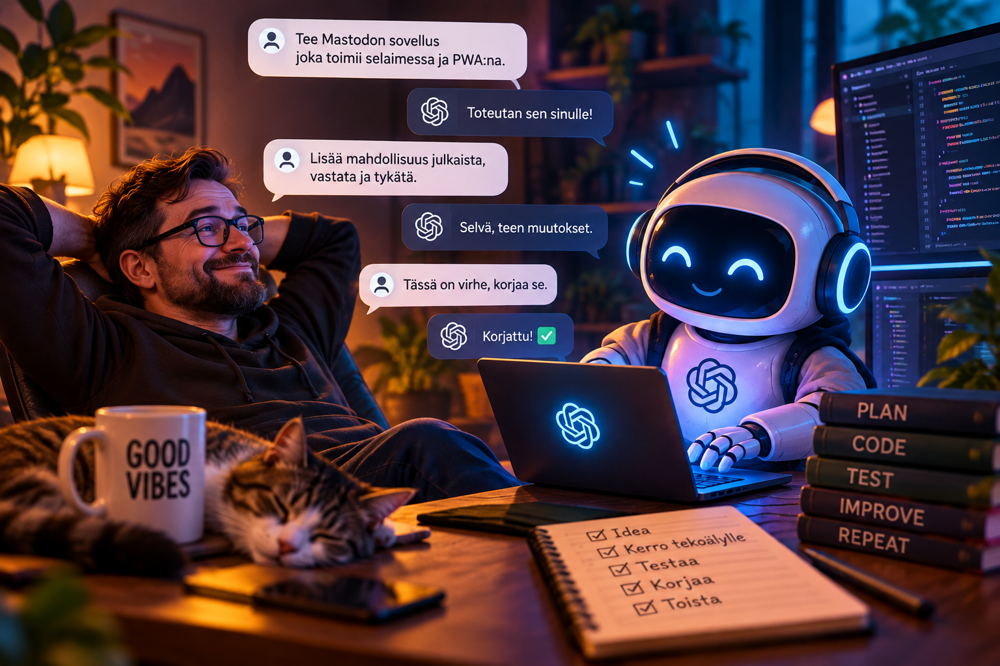
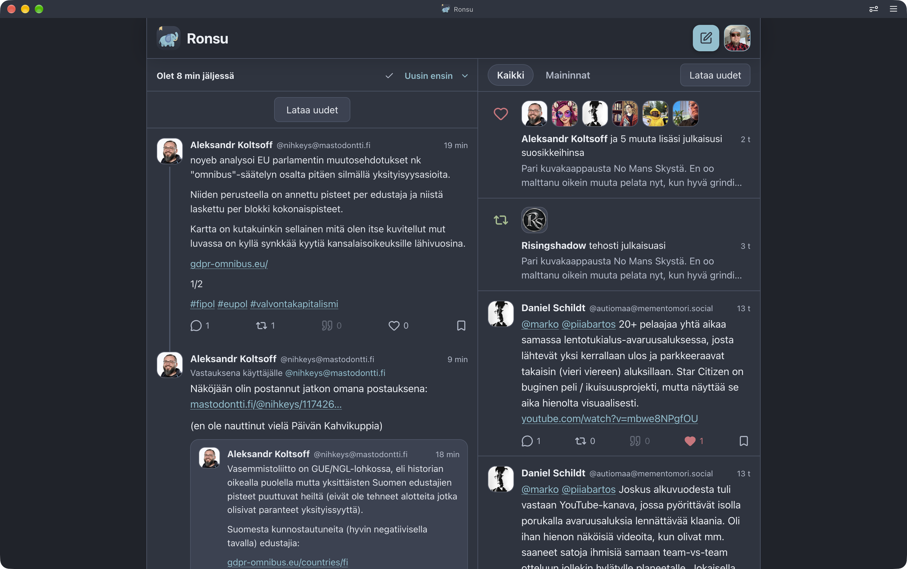
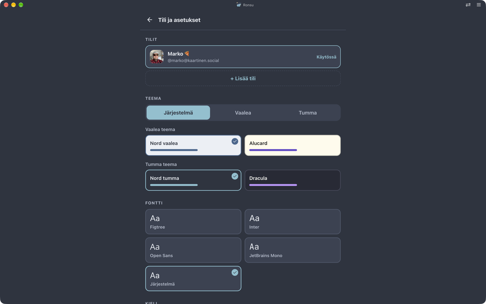
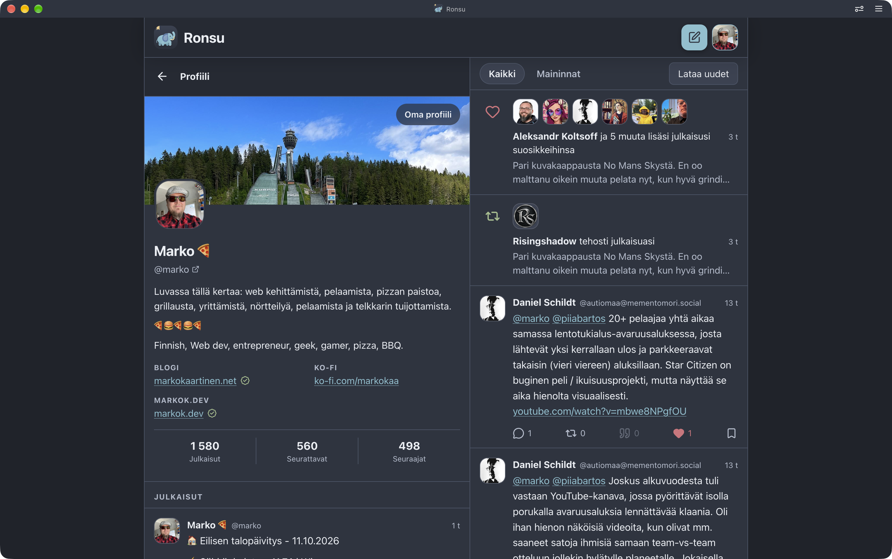
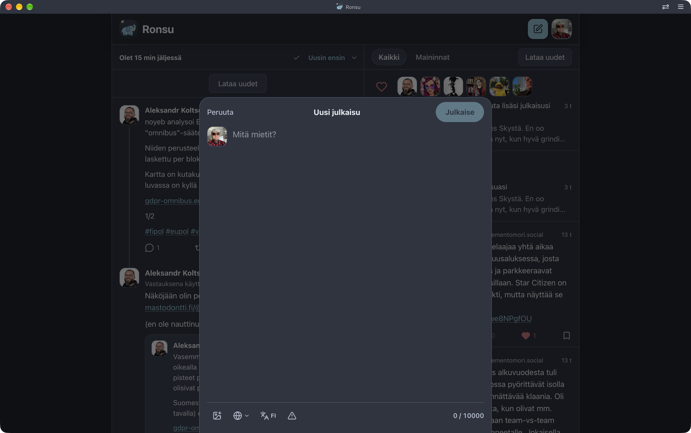
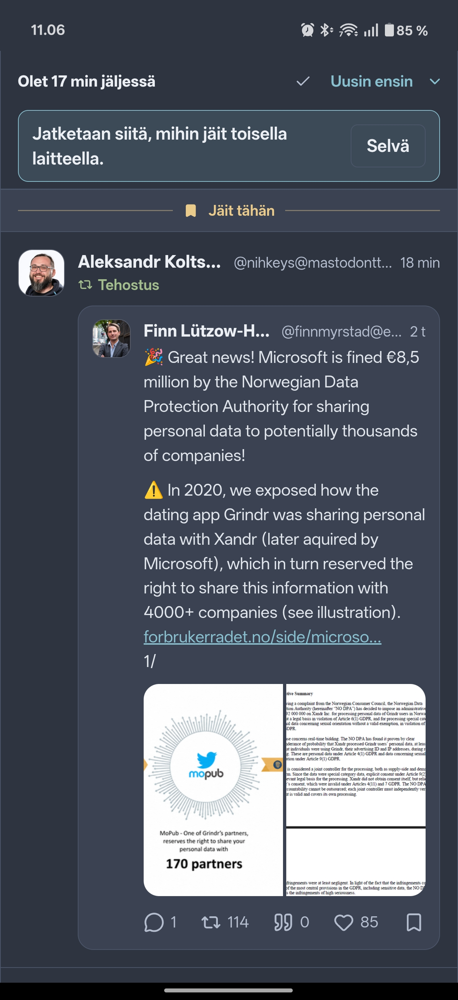
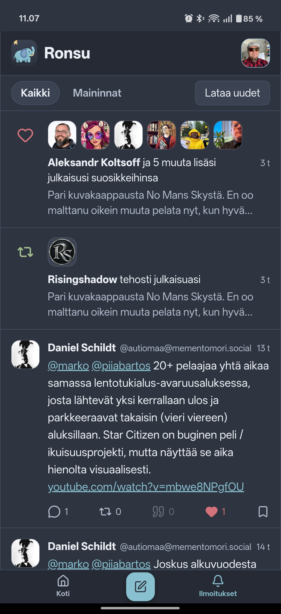
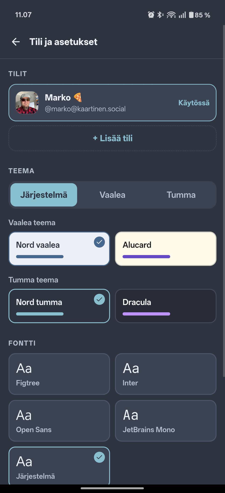
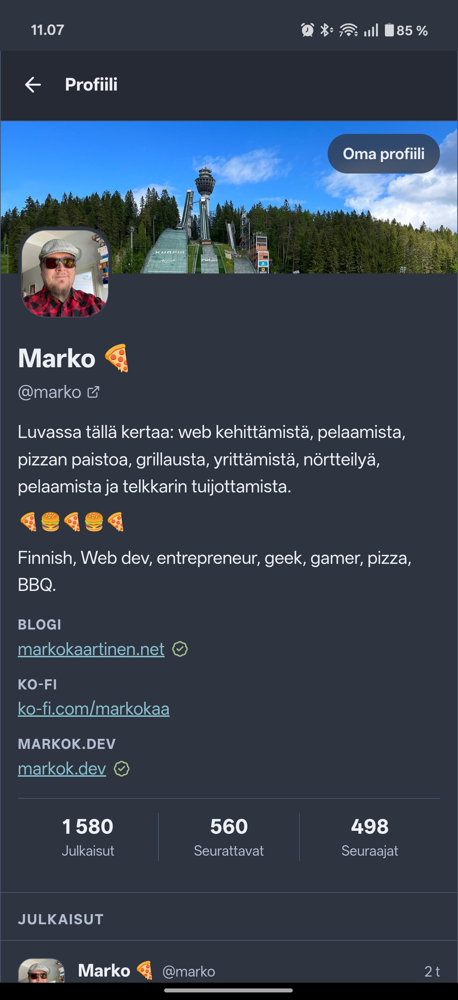
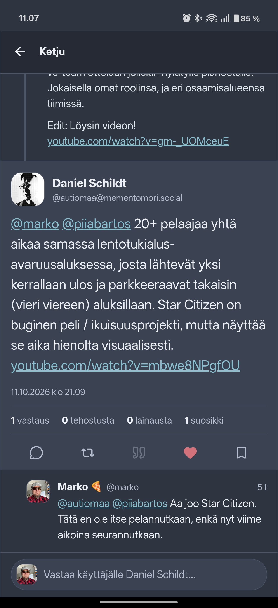


You read the title right. I vibe coded my own Mastodon app entirely with the help of AI. Let me tell you a bit about why and how.


I thought for a long time about whether to write about this at all, since it's a bit of a hot potato everywhere right now. But I decided to write it anyway, because I ended up with something useful for myself, and others might find it interesting too.

I know this may bring some fairly sharp opinions and comments via Mastodon and the blog's comments. Please try to be kind and decent anyway. If AI really rubs you the wrong way, stop reading here — at least before the AI-generated image shows up 😆

## Vibe coding?

First, let's open up what on earth vibe coding is. In short, you let the AI do the work.

In practice, you write or speak to the AI about what it should do, and the AI handles the coding. If there are problems or errors, you throw the error message at the AI and it fixes them. Likewise, if you want changes, you tell the AI again.

In my [How I Use AI](/blog/how-i-use-ai/) article I wrote about how I use AI myself. I'm not much of a vibe coder, but this time I decided to give it a go and let the AI do the work.

In this project it went like this: I told the AI what I wanted, how I wanted it to work, and what features the first version should have.

After that, once I had the first version working, we developed it piece by piece. It's not finished yet.

I used Claude Code to build the project, and it did the actual coding. I used ChatGPT for planning features, defining requirements and bouncing ideas around. The tech stack ended up being Svelte 5, TypeScript and Vite. Svelte wasn't familiar to me beforehand, but I already had experience with Vite and TypeScript. Still, I let the AI handle the technical implementation fairly independently.

## Ronsu

The result is **Ronsu**. Ronsu is a Mastodon app designed to work as a PWA. You can of course use it in a regular web browser, but I use it as a PWA on both my phone and my computer.

The idea for Ronsu came when I switched to an Android phone this spring. I no longer had the Mona app, and my reading position didn't sync anymore. I couldn't really find suitable software to achieve this, so I decided to put the AI to work and see what it would come up with.

With Ronsu you pick up where you left off on any device. Or at least that's how it's supposed to work, and in my experience it works quite okay, and the AI has improved it whenever I've asked.

Ronsu also has no backend server of its own. It runs entirely in the browser and talks directly to the Mastodon server. Your reading position is stored using Mastodon's own API, so no separate service is needed to sync it.

You can find Ronsu on [GitHub](https://github.com/MarkoKaartinen/ronsu), and you can also try it directly at [ronsu.markok.dev](https://ronsu.markok.dev/).

I've been using it for a while now, and it has become my main way of browsing Mastodon.

So this is completely coded by AI. I've gone through the code myself, but I haven't written it. The logo was made by AI as well.

Right now Ronsu lets you follow your own feed, publish posts, reply, quote, boost, favourite and see your notifications. More features will come as I need them.

The idea in Ronsu is also to *read* your feed rather than just scroll endlessly. You can start from the oldest unread post and work your way toward the newest. The app also shows how far behind the latest posts you are, in terms of time.

Ronsu on a large screen:





And on a phone:





It's opinionated, meaning it works the way I'd like things to work. So things might change in some direction if I feel like it. There are probably a few quirks and bugs too, and surely things I haven't considered yet or run into.

## Closing thoughts

Vibe coding has become much more common lately, and AI-made apps seem to keep appearing. The tools have developed to the point where almost anyone can create at least some kind of working app without actual programming skills. That's a great thing in itself, since many ideas can now turn into real, working apps.

At the same time, there's of course a flip side. When apps are this easy to make, they also get published without the maker necessarily understanding what the AI actually did. Security, maintainability and all sorts of other problems may go unnoticed. A working app doesn't automatically mean a good or secure app.

And even if you can get the first version done quickly with AI, the app still has to be maintained and developed going forward. It'll be interesting to see what happens when there are more AI-built apps out there and their makers have to sort out problems years down the road.

This has been an interesting experience, and to be honest I could have built this myself too. Maybe not with the technologies the AI used, but the end result would have been similar.

It was admittedly the easy way, and it's kind of "fun" to develop this way, since you can ask the AI to build features and then test them yourself. What's missing is the joy of making it yourself and the personal touch that comes from writing the code.

I also understand the criticism aimed at vibe coding very well. AI can produce code that looks like it works, but that doesn't mean the code is necessarily good, secure or even sensibly implemented. The responsibility for the result still lies with whoever publishes and uses the app.

Since I got something usable out of this and use it myself right now, I ask the AI to improve it whenever something comes to mind or I run into something. It definitely doesn't have all the features. If you like, put your own AI to work and make a PR!


This article was first published on my [blog](https://markokaartinen.net/2026/vibekoodasin-mastodon-sovelluksen) in Finnish. This English version was translated with the help of AI.

